# Focus Board

<p align="center">
  A kanban board for your bb threads, grouped by what needs your attention.
</p>

<p align="center">
  <a href="#install"></a>
  <a href="https://getbb.app/marketplace/focus-board"></a>
  
  <a href="LICENSE"></a>
</p>

<p align="center">
  <a href="docs/screenshots/board-thread-pane-dark.png">
    <picture>
      <source media="(prefers-color-scheme: dark)" srcset="docs/screenshots/board-thread-pane-dark.png">
      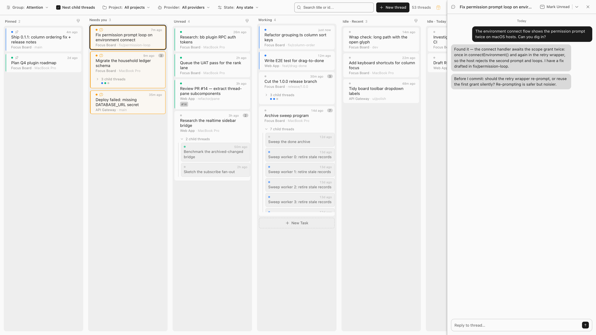
    </picture>
  </a>
</p>

> [!NOTE]
> **What is bb?** An open-source, local-first IDE for coding agents — Claude Code, Codex, Cursor, Pi, OpenCode, and more — where work runs in *threads*: live agent conversations you can follow, steer mid-run, or hand off. Focus Board is a bb *plugin* that turns those threads into a kanban board. Learn more at [getbb.app](https://getbb.app) or [github.com/get-bb/bb](https://github.com/get-bb/bb).

## What it does

The board lives in bb's sidebar as a nav panel and updates in real time as your threads change. Lanes read left to right in order of attention: **Pinned, Needs you, Unread, Working**, then idle threads bucketed by how long they've been quiet.

- **Group and filter** — lanes by Focus, Last activity, Project, Provider, Machine, Group, or Parent thread; filter and search by state, project, provider, feature group (with a "No group" bucket for unassigned threads), or title. In the Group view, a column header's eye button hides that group — the filter's menu row unhides it.
- **Zoom to family** — right-click a family card and choose "Zoom to family" to open the Parent view filtered to just that family; the toolbar's family chip names it and clears the scope.
- **Drag to act** — hand-order a column, drop a card on Pinned, Unread, or Done to change its state in the same drag, or drop it onto a card's middle to nest it as that thread's child; drag a nested child onto any column header (they grow and ring amber during family drags; a title drop never writes an order — placement is the insertion line's job) or floor to top-level it again, and back onto a card to re-nest.
- **Spawn children from the board** — "New child thread…" in the card and pane menus opens the composer preset to the parent's project and checkout; the child lands nested under its parent in the pane.
- **✨ auto-rename** — the pane's title editor can title the thread from its opening prompt with bb's AI services, falling back to the thread's own model when the pinned service can't.
- **Thread pane** — open a card to read and reply beside the board; full screen on phone. Agent questions are answered right from the pane, and the header's menu opens the workspace in your editor, file explorer, or terminal.
- **Snooze** — "Snooze…" reads a thread now and marks it unread again at the time you pick.
- **Sweep** — every lane carries a sweep with its own destination: stale Done threads archive, long-idle threads move to Done, Pinned unpins, Unread marks read. Shift-click and ⌘/Ctrl-click multi-select before sweeping. The Parent view's rows carry the same sweep, spanning every family lane in that row.
- **Ticket chips** for GitHub issue and PR refs in the title or branch, with status dots (the official GitHub plugin's cache feeds them). A `#N` on the project's remote only chips when it can be validated — a GitHub item confirmed in the GitHub plugin's cache, or any tracker URL that answers HTTP; unvalidated text like `PROJ-123` or `GLM-5` never chips. Forgejo remotes build their own `…/issues/N` links and non-GitHub chips show the site's favicon. A thread whose text names nothing can still carry a chip: the board's own link store ties a thread to any tracker item explicitly (the `focus_board_link_issue` agent tool, or `bb focus-board link set` GitHub URLs, issue numbers, or any https URL with an optional `--label`).
- **What's new** — a 🎁 toolbar button lists recent changes after an update.

Finer behavior notes (hand-ordering rules, Escape handling, pin behavior, pane history) live in [docs/features.md](docs/features.md).

## Screenshots

<p align="center">
  <a href="docs/screenshots/overview.gif">
    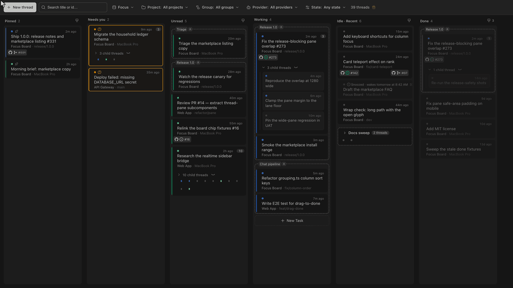
  </a>
  <br>
  <strong>Overview</strong>. A group folds into its dot-grid card, a card drops onto a parent inside another group, a card joins a group of one, and the Done projection stays in view.
</p>

<p align="center">
  <a href="docs/screenshots/overview-groups.png">
    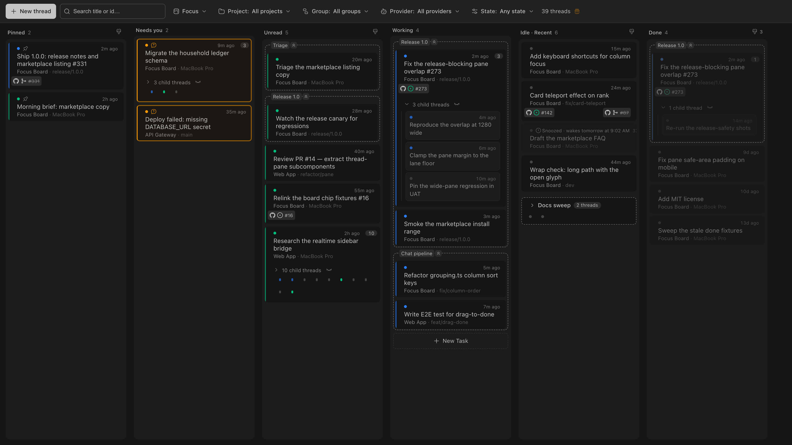
  </a>
  <br>
  <strong>Feature groups</strong>. Sibling threads share a dashed frame, one frame per lane. Release 1.0 spans Unread, Working and Done; Chat pipeline folds; Triage holds one card.
</p>

<p align="center">
  <a href="docs/screenshots/overview-group-highlight.png">
    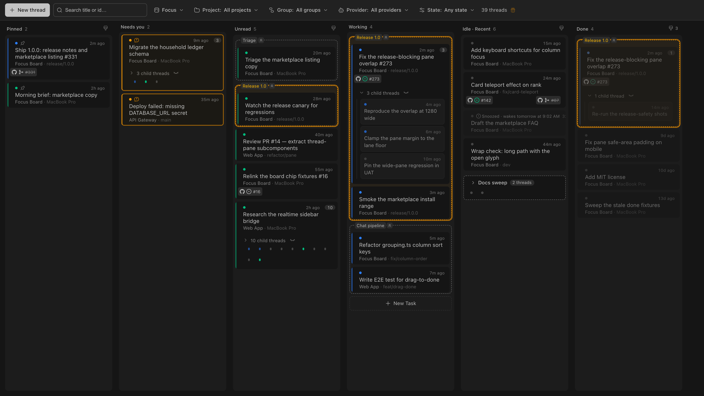
  </a>
  &nbsp;&nbsp;
  <a href="docs/screenshots/overview-group-dots.png">
    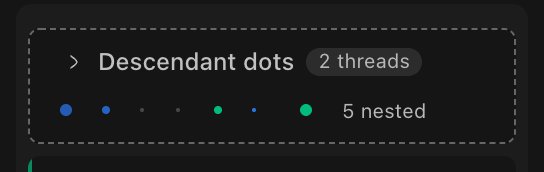
  </a>
  <br>
  <strong>Group footprint and folded dots</strong>. Clicking a frame lights it in every lane it touches; a folded card keeps its subtree readable at three dot sizes.
</p>

<p align="center">
  <a href="docs/screenshots/overview-group-menu.png">
    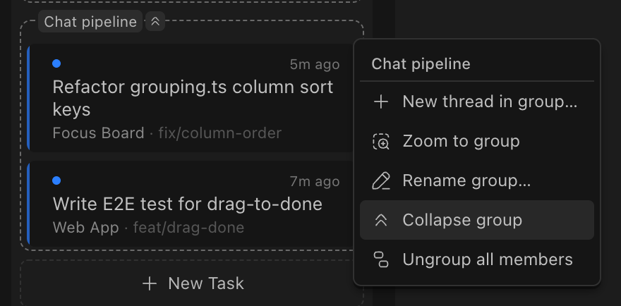
  </a>
  &nbsp;&nbsp;
  <a href="docs/screenshots/overview-card-menu.png">
    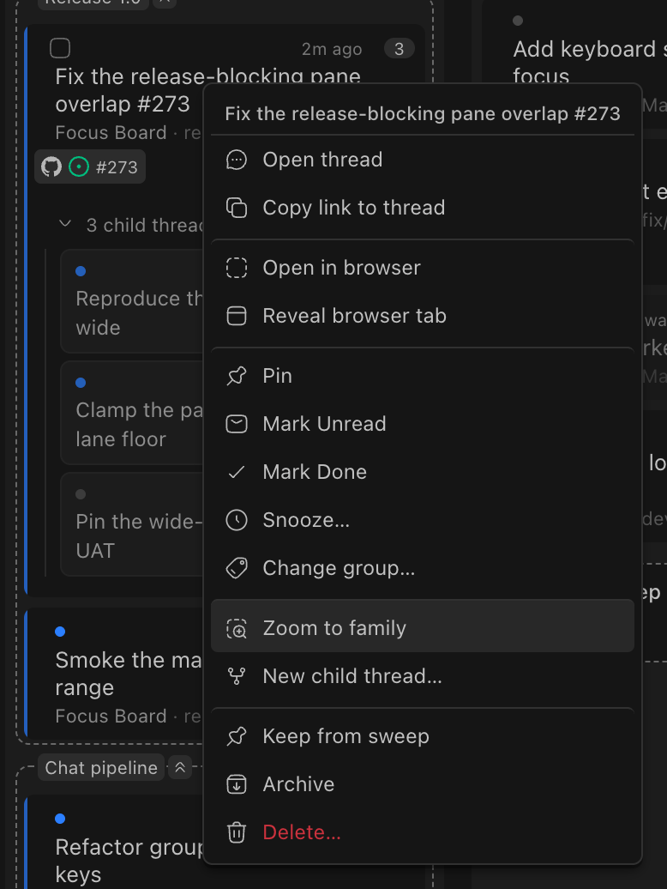
  </a>
  <br>
  <strong>Menus</strong>. A group frame offers spawn, zoom, rename, fold and ungroup; a card offers pin, read, done, snooze, group, zoom, spawn, keep and archive.
</p>

<p align="center">
  <a href="docs/screenshots/overview-group-picker.png">
    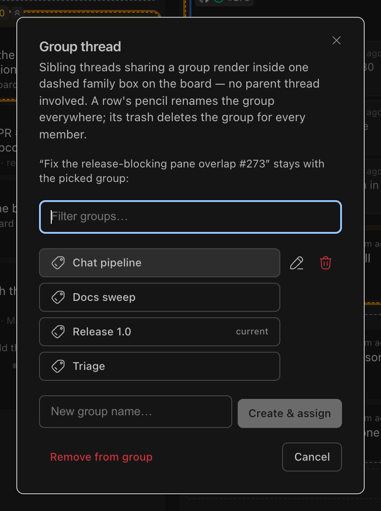
  </a>
  &nbsp;&nbsp;
  <a href="docs/screenshots/overview-group-filter.png">
    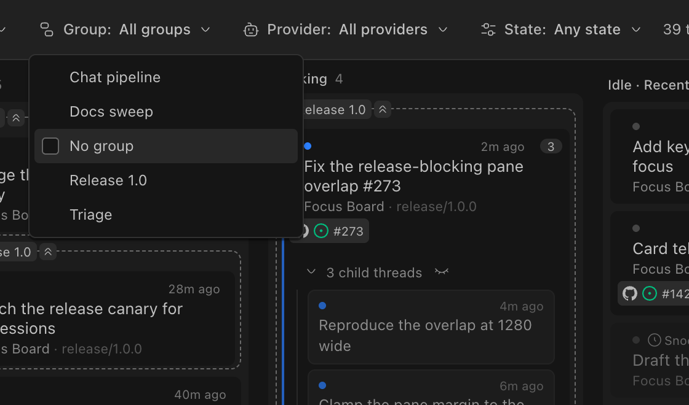
  </a>
  <br>
  <strong>Group picker and Group filter</strong>. Assign or create a group from a card; restrict the board to chosen groups, with a No group bucket for unassigned threads.
</p>

<p align="center">
  <a href="docs/screenshots/overview-view-menu.png">
    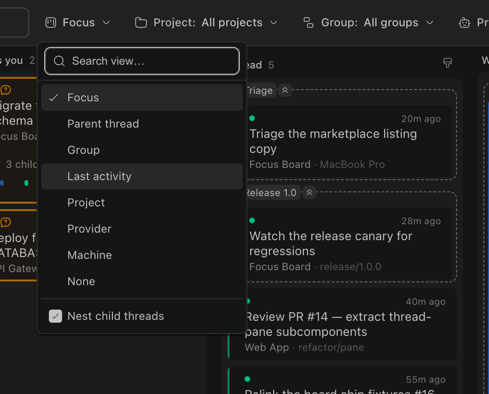
  </a>
  &nbsp;&nbsp;
  <a href="docs/screenshots/overview-done-sweep.png">
    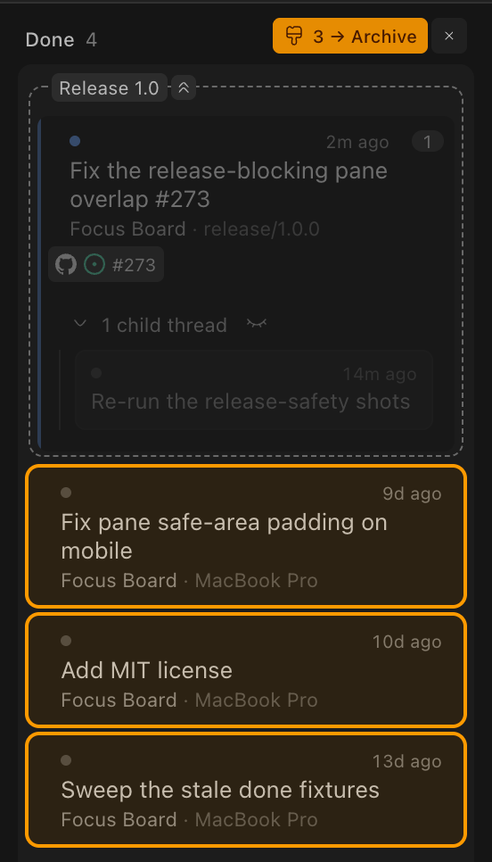
  </a>
  <br>
  <strong>Views and sweep</strong>. Eight ways to bucket the board, and the Done lane armed with its destination named and its settled cards tinted.
</p>

<p align="center">
  <a href="docs/screenshots/overview-family-fold.png">
    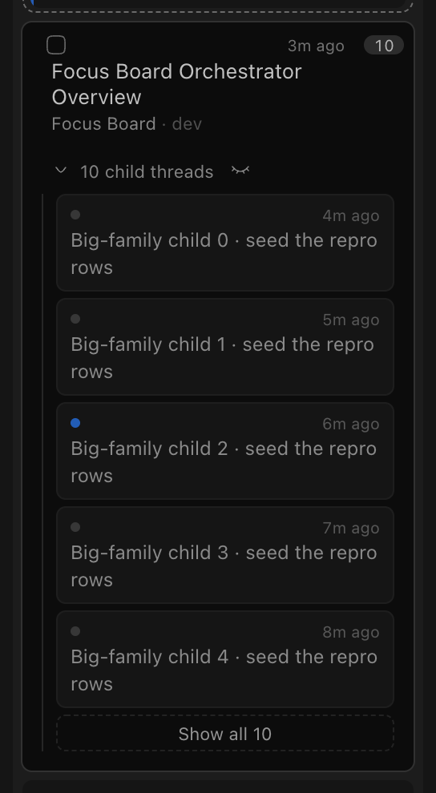
  </a>
  &nbsp;&nbsp;
  <a href="docs/screenshots/overview-horizontal-wallpaper.png">
    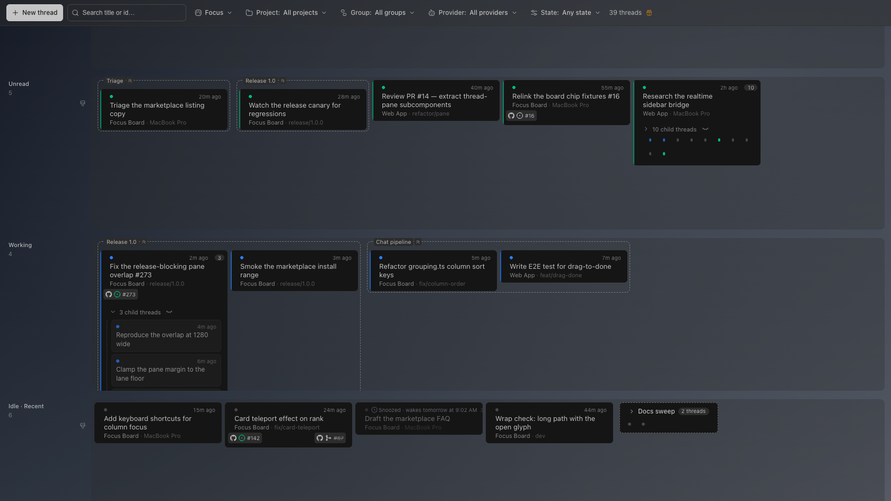
  </a>
  <br>
  <strong>Long families and horizontal lanes</strong>. A family past five rows folds behind Show all N; horizontal lane rows over a bundled wallpaper.
</p>

<p align="center">
  <a href="docs/screenshots/overview-parent-view.png">
    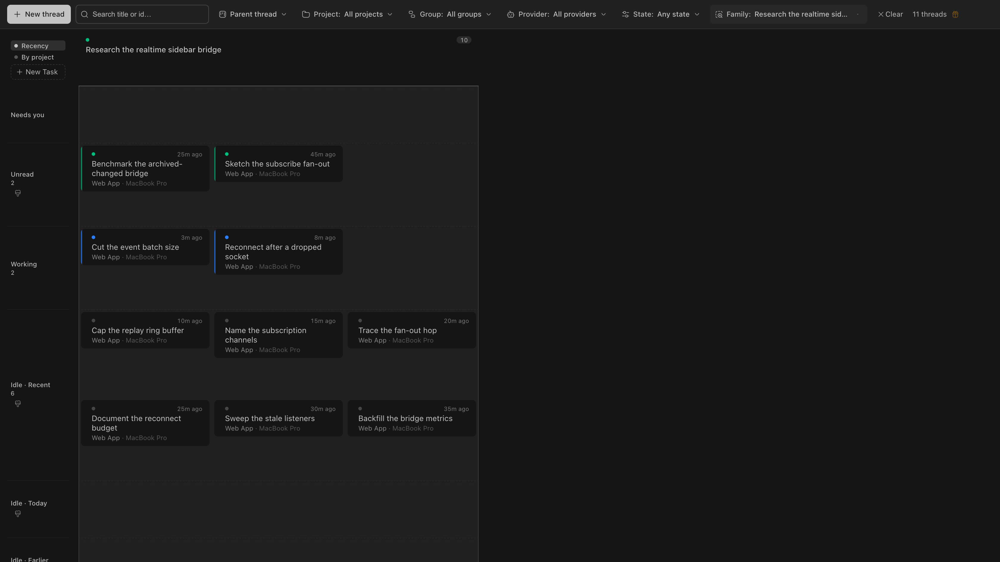
  </a>
  <br>
  <strong>Zoom to family</strong>. The Parent view opens scoped to one family: every state lane for that family, its row sweeps, and the Family chip that clears the scope.
</p>

<p align="center">
  <a href="docs/screenshots/board-thread-pane-dark.png">
    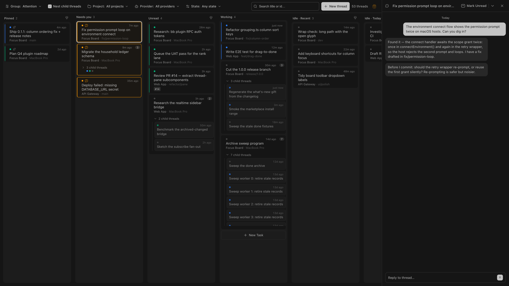
  </a>
  <br>
  <strong>Thread pane</strong>. Opening a card slides in the conversation alongside the board.
</p>

<p align="center">
  <a href="docs/screenshots/phone-board-light.png">
    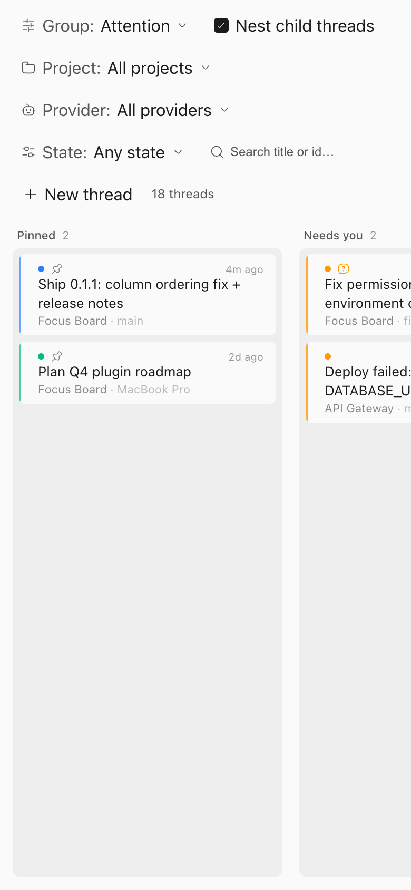
  </a>
  &nbsp;&nbsp;
  <a href="docs/screenshots/phone-thread-pane-dark.png">
    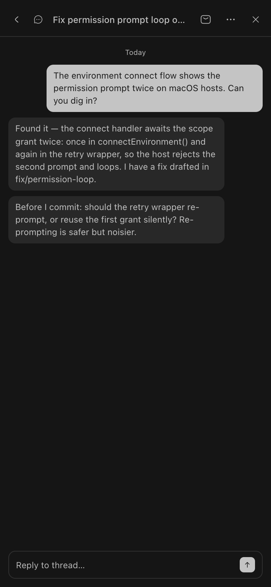
  </a>
  <br>
  <strong>Phone</strong>. The toolbar stacks and columns scroll horizontally; the thread pane goes full screen.
</p>

The full feature outline, including what these images deliberately leave out, lives in [docs/screenshots/overview-coverage.md](docs/screenshots/overview-coverage.md).

## Requirements

- Node ≥ 18
- bb ≥ 0.43 with plugin SDK ≥ 0.5.9
- Optional: the official GitHub plugin, for ticket status dots. Without its
  local cache, chips render without dots and everything else works.

## Install

Focus Board is listed on the bb community marketplace
([getbb.app/marketplace/focus-board](https://getbb.app/marketplace/focus-board)),
so the short name installs it:

```sh
bb plugin install focus-board
```

To update later, run the same command again (add `--yes` to skip the
confirmation prompt). Straight from GitHub works too, with or without a
pinned tag:

```sh
bb plugin install https://github.com/cristoslc/bb-plugin-focus-board
bb plugin install git:https://github.com/cristoslc/bb-plugin-focus-board@<tag>
```

With the upcoming 1.0 release, the CLI, stored state, and realtime payload
shapes become stable commitments — the details live in
[docs/compatibility-1.0.md](docs/compatibility-1.0.md).

## Configuration

Set sweep thresholds in Settings → Installed plugins or with the CLI. Each
threshold is a count plus a unit (hours, days, or weeks); both default to
2 days:

| Setting | Default | Effect |
|---|---|---|
| `doneArchiveValue` | 2 | Done threads older than this (in `doneArchiveUnit`) become sweep-eligible |
| `doneArchiveUnit` | days | Unit for the Done threshold: `hours`, `days`, or `weeks` |
| `idleArchiveValue` | 2 | Threads idle longer than this (in `idleArchiveUnit`) become sweep-eligible |
| `idleArchiveUnit` | days | Unit for the idle threshold: `hours`, `days`, or `weeks` |

Any thread can be exempted from both sweeps with the card-menu
"Keep from sweep" override.

## CLI

The plugin registers one `bb` subcommand for managing its own state:

```sh
bb focus-board done list [--json]
bb focus-board done mark <thread-id>...
bb focus-board done clear <thread-id>...
bb focus-board group list [--json]
bb focus-board group create <name>
bb focus-board group rename <group> <name>
bb focus-board group delete <group>
bb focus-board group add <group> <thread-id>...
bb focus-board group remove <thread-id>...
bb focus-board group move <thread-id>... --to <group>
bb focus-board link list [--json]
bb focus-board link set <thread-id> <number-or-url> [--repo owner/repo] [--pull] [--label text]
bb focus-board link clear <thread-id> [<number>...]
bb focus-board snooze list
bb focus-board snooze set <when> <thread-id>...   # +<N>m|h|d|w or a future timestamp
bb focus-board snooze clear <thread-id>...
bb focus-board autotitle availability|prompt|probe --thread-id <thread-id>
bb focus-board sweep [--ids <id>...] [--confirm]
bb plugin config focus-board                       # declared settings (sweep thresholds, pane Escape, scroll debug)
```

All commands accept `--json`. The sweep never archives without `--confirm`;
without it the command is a dry-run: it prints what would be archived and
exits 1. Sweep thresholds live in the declared settings above, editable from
`bb plugin config focus-board` or the board settings modal's Behavior tab.

## Data and privacy

The board reads bb's live thread view through the plugin SDK and writes only
pin state, read state, Done marks, feature-group assignments, and per-thread
tracker-item links (GitHub
issues/PRs and other https tracker items) through bb's own stores — never
thread content. For ticket status dots it reads the official GitHub plugin's
local cache read-only; validating a text-scanned `#N` may also fetch the item
URL once over HTTP (the answer is cached, fresh GitHub cache hits are never
refetched). Nothing leaves your machine beyond those tracker checks.

## Development

```sh
npm install
bb plugin build
bb plugin install . --yes
bb plugin reload focus-board
# or: bb plugin dev
npm test           # vitest
npx tsc --noEmit   # typecheck
```

The screenshots in `docs/screenshots/` are captured with a harness in
`scripts/screenshot/` — see its README for usage.

## Contributing

Issues and PRs are welcome at
[github.com/cristoslc/bb-plugin-focus-board](https://github.com/cristoslc/bb-plugin-focus-board).
Read [CONTRIBUTING.md](CONTRIBUTING.md) first; it covers people and AI agents
alike. Run `npm test` and `npx tsc --noEmit` before submitting, and report
security problems privately per [SECURITY.md](SECURITY.md).

## License

[MIT](LICENSE).

## Changelog

Notable changes are documented in [CHANGELOG.md](CHANGELOG.md).