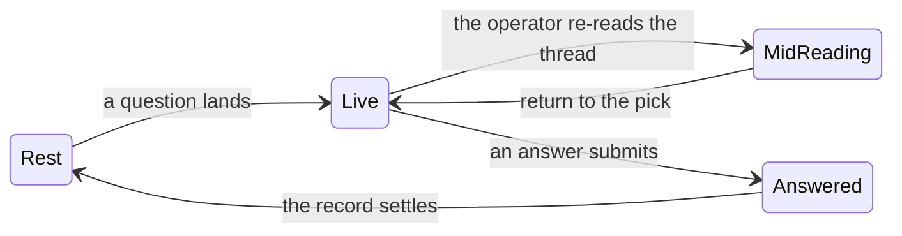

# Interaction surface: decision picker plus decision history

The design note that [issue #159](https://github.com/cristoslc/bb-plugin-focus-board/issues/159) asks for before implementation. It covers the surface's states for desktop and phone and the mechanics that could serve each one. It states options and a recommendation per state, and it leaves the final shape to the operator. No component changes ride with it.

This note is bluework. It carries the thinking from a draft on an unmerged branch (`bb/fix-focusboard-ux-thr_3a4twsefrp`, commit `690b4a8`) forward to `dev` at `77e8f57`, corrects what the two weeks since then changed, and supersedes it. The branch also holds `PURPOSE.md` (commit `6e10611`), the attention philosophy the issue cites, which now lives on `dev` at [PURPOSE.md](../../PURPOSE.md); this note quotes the philosophy it depends on and links it.

## Governing rule

Every mechanic below is judged by one test, taken from the issue and the philosophy it rests on:

- Attention cannot be split or saved, so the surface takes only the attention it needs and gives complete, parseable context at the point of decision.
- One glanceable decision, complete context, no hunting.
- Amber means "the operator is needed". The live question carries the board's amber language. Decision history is a neutral record and never borrows that urgency.

## Where the surface stands at `77e8f57`

- The pane mounts two sibling cards above the transcript: `PendingInteractionCard` at `components/thread-pane.tsx:1157` and `DecidedQuestionsCard` at `:1162`, imported at `:22-23`.
- The picker is 1086 lines (`components/pending-interaction-card.tsx`), the history card 232 (`components/decided-questions-card.tsx`). Both wear the same casing, `mx-3 mt-2 shrink-0 overflow-hidden rounded-lg border border-border bg-card shadow-sm` (`:1010` and `:160`). Neither carries amber, so the visual split #97 asked for has not shipped even though #97 was closed as superseded on 2026-10-15.
- The picker's state model is already durable in the right places. Answers mirror into localStorage under `focus-board:questionDraft:<threadId>:<interactionId>` (`:232-236`), with the question step clamped into range (`:298-306`), written as the operator works (`:576`), and cleared on submit or dismiss (`:947`, `:975`).
- The picker's body caps at `max-h-[45dvh]` (`BODY_MAX_CLASS` at `:90`, applied `:726`) and scrolls internally, so a long question cannot push the transcript off the screen.
- The history reads decisions out of the raw event log through `lib/decisions.ts`, keeps five (`MAX_DECISIONS = 5` at `components/decided-questions-card.tsx:26`), sits collapsed, and auto-expands once when a fresh answer lands (`:81-88`). It is the only record the pane offers, because bb drops the transcript trace (upstream get-bb/bb#4463).
- Geometry matters more than the issue assumed. The pane is `flex h-full min-h-0 flex-col` with no scroll of its own (`components/thread-pane.tsx:901`), the two cards are `shrink-0`, and the only scroller is the host's `.thread-scrollbar` inside the embedded chat, which the pane finds by query rather than owning (`:802-805`). So on desktop the picker never scrolls out of view. What the operator loses during a re-read is salience and vertical room, not the card's position.
- Two compact modes already exist: `isCompact` (`:510`) from a compact window or a panel narrower than `PANE_SHEET_MAX_PANEL_WIDTH = 640` (`:68`), and `panelScopedSheet` (`:515`) for a narrow panel on a desktop window. Phone mechanics should ride that split, not invent a third.

## The four states

| State | What the operator is doing | What the surface owes |
| --- | --- | --- |
| Rest | Catching up on what was already decided | A quiet, parseable record: what was asked, what was chosen, when |
| Live | Choosing an option | Complete decision context, the highest contrast on screen, amber |
| Mid-reading | Re-reading the thread, then coming back | The pick and any draft survive, and the choice is one step away |
| Answered | Confirming the outcome | One visible just-answered beat, then a settle into Rest |

## Desktop mechanics

### Rest

Today's behavior is close to right and needs presentation, not structure. The history card stays a collapsed strip with a count, and expands to rows carrying header chip, time, prompt and answer (`components/decided-questions-card.tsx:197-230`).

Options: leave the casing as is, or give the record a neutral rule that visually rhymes with the picker without borrowing amber.

Recommendation: keep the layout, drop the generic card chrome for a neutral left-edge rule shared with the picker, so shape says family and color only says urgency. Cheap, and it satisfies the surviving half of #97.

### Live

Options:

- **A. Styled dock in place.** Keep both cards docked, amber only on the live one. Smallest diff, no plumbing risk, and the card is already always visible.
- **B. Floating overlay.** One overlay over the pane, the decision centered, the conversation dimmed behind it, an at-rest reminder dot in the header when a decision arrived while closed. Sharpest reading of the philosophy, highest cost: it has to coexist with the pane's click-capture and Escape handling, and it covers the transcript it wants you to read.
- **C. Two-pane split.** A narrow right column serves picker and history while the chat stays left. Best structural answer to co-visibility, costs width the pane rarely has, unusable as the only shape.

Recommendation: A for the first cut, with B prototyped behind a screenshot mock before any commitment. A is not a compromise on the philosophy: the card is docked and always visible, so the decision already owns a permanent slot on screen. What A must add is the amber casing and a step indicator that survives a collapse (the form already knows `step + 1 of questions.length` at `components/pending-interaction-card.tsx:533`).

### Mid-reading

This is where the issue's assumption needs correcting. There is no scroll-away to hook, because the pane's column does not scroll and the card is `shrink-0`. The excursion happens inside the transcript's own scroller, which the pane does not own.

Options:

- **A1. Yield and return.** When the operator interacts with the transcript, the expanded card folds to a one-line amber rail naming the question and the step, handing its height back to the chat. One click re-expands it at the same step with drafts intact, which the localStorage draft already guarantees.
- **A2. Persistent amber rail above a collapsible body.** The body folds by hand as today, and the rail becomes the fixed home of the question, the step, and the return control. Simpler than A1, no transcript interaction needed.
- **B1. Overlay travels with attention.** The pick floats above the transcript so it is always at the decision point. Strong, but it is the overlay by another name, with the same plumbing risk.

Recommendation: A2 first, A1 as the follow-on if the manual fold still feels like hunting. A2 needs no observer on host DOM and no new state beyond the existing `expanded` flag.

### Answered

The history card already auto-expands once on a newer sequence (`:81-88`) and stays collapsed otherwise. Recommendation: keep it, and add one thing only, a neutral "just decided" mark on the row that landed, cleared by the next decision or by collapsing. No toast, no banner, no amber.

## Phone mechanics

The test does not change with the mechanics. The pane is either a fixed full-window sheet (`windowCompact`) or a panel-scoped absolute sheet (`panelScopedSheet`), and the same two cards sit above a short column.

### Rest

A collapsed history strip at the top of the sheet, one line tall, as today. The count is enough until the operator asks for more. Recommendation: unchanged.

### Live

Options:

- Bottom-anchored sheet for the question body, thumb-reachable, amber header, with the transcript visible above it.
- The docked card as today, at `max-h-[45dvh]`, which on a phone leaves roughly half the window for the transcript.

Recommendation: the docked card, with the 45dvh cap kept and the option list given a shorter cap on coarse pointers. A bottom sheet is a genuinely different surface with its own dismiss, drag, and safe-area work, and the current cap already prevents the worst outcome. If the operator wants the sheet, it is a second cut with its own mock.

### Mid-reading

The same yield-and-return as desktop, and here it earns more, because height is the scarce resource. Recommendation: A2, the amber rail plus a foldable body, with the fold persisted per interaction so a returning operator finds it as they left it.

### Answered

The sheet hands over to the history strip in place, one glance, then quiet. No second surface opens.

## What history owes, in every layout

- A record, not a log dump: question, chosen option, time, one line each. The card already reconstructs this; the work is truncation and typography.
- Neutral always: no amber, no pulse, no borrowed urgency.
- Kinship with the picker through structure, not color.
- The five-decision cap stays a cap. Paging or a view-all path is a separate decision, and the transcript already holds the full record.

## What is still open for you

1. **The desktop shape.** A (styled dock) now with B (overlay) behind a mock, or B straight away. Recommendation: A now.
2. **The mid-reading mechanic.** A2 (amber rail plus foldable body) is the recommendation. A1 (auto-yield on transcript interaction) is the more opinionated version, and it depends on watching host DOM the pane does not own.
3. **The phone form.** Docked card with the 45dvh cap, or a bottom sheet as a second cut. Recommendation: docked card.
4. **Whether `PURPOSE.md` lands at all.** The philosophy this note quotes lives only on an unmerged branch. Landing it, rewriting it, or dropping the dependency are all defensible; silence leaves the next agent quoting a file that is not there.

## Test surface

- `tests/pending-interaction-card.test.ts` and `tests/pending-interaction-card-draft.test.tsx` for the picker's structure, the rail, and draft survival across a fold.
- `tests/decided-questions-card.test.tsx` for the neutral restyle, the auto-expand beat, and the just-decided mark.
- The eight pane suites that mock both cards (`tests/thread-pane-escape`, `-actions`, `-narrow-panel`, `-reference-chips`, `-coarse-controls`, `-queued-send-reveal`, `-workspace-open`, and `tests/pane-context-row`) move in the same commit as any module rename.
- `scripts/screenshot` captures desktop and phone in all four states, before and after, per the issue's acceptance item 5.
- `docs/test-coverage-matrix.md:153-154` gains the new states when behavior lands.

## Landing, when you say go

Two cuts, in this order. Cut one: amber casing on the live picker, neutral history casing, the amber rail, and the step indicator on the collapsed card, with the tests above. Cut two: whatever desktop shape you pick after the mock, plus the phone form if it changes. Each cut is its own PR against `dev` with its own changelog bullet under a thread pane surface.

> AGENT GENERATED CONTENT
