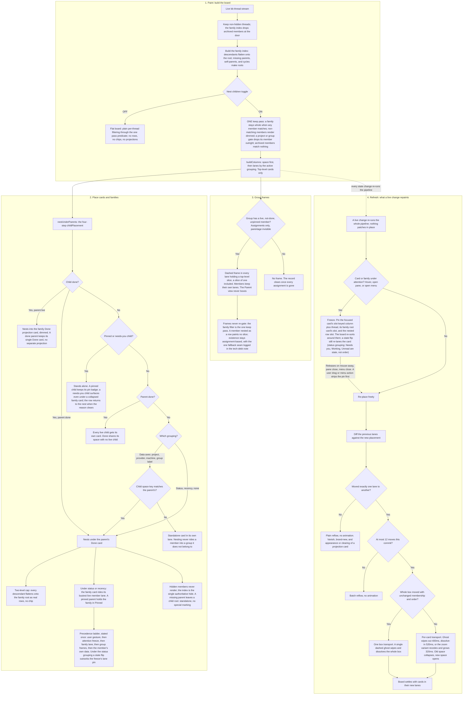

# Family and card painting and refreshing: the ruleset of record

The column board's painting (placement) and refreshing (repaint on live
change) rules, as implemented after the 2026-10-13 audit. The audit came
twofold: an operator-guided trace in thread `thr_wdg23bqem3`, and an
independent derivation by a blind Claude Opus 5.5 thread (`thr_zeyu4phivu`),
whose ruleset this doc merges with the operator's rulings. Sources:
`app.tsx`, `components/nesting.ts`, `components/group-boxes.ts`,
`components/attention-freeze.ts`, `components/card-transport.ts`,
`components/grouping.ts`, and [the nesting plan](plans/bb-sashay-parent-child-nested-cards-thr_aap36j6yz4.md)
(its Refinement round 3 records the superseded decisions).

## Vocabulary

- **Card:** a thread drawn on its own in a lane. **Row:** a thread drawn under
  a card. **Root:** a thread with no visible parent.
- **Family:** a root plus its visible descendants, flattened to one level.
- **Space:** where a card lives: Done, Pinned, or the live board. **Lane:** a
  column of the column board.
- **Attention:** the pointer is on a card, the card's pane is open, or its
  menu is open.

## The diagram

## The rules

### Input and filtering

1. **Visible set.** The board draws only threads that are neither hidden nor
   archived; every later rule runs on that set. Owner: `app.tsx` (hidden),
   `components/nesting.ts` `buildFamilyIndex` (archived dropped at the door).
2. **Family.** A family is a root plus all visible descendants flattened under
   it. A missing parent, a self-parent, or a parent cycle makes a thread a
   root; corrupt data never hangs the board.
3. **One match test.** One exported predicate (`threadPassesFilter`,
   `components/grouping.ts`) decides pass/fail for every entry point: project,
   provider, state (or one idle age bucket), the feature-group gate, and
   search across titles, ids, branches, group names, and ticket chips.
4. **One keep pass.** The family filter is the board's only filter rule. A
   unit (the family with nesting on, otherwise the thread) passes when any
   member matches; non-matching members render dimmed; a project or group
   gate drops its member outright (the column-gate policy). Group frames
   never re-gate this output: the pass that used to is deleted.

### Placement

5. **Space first.** Done goes to the Done lane, a pinned thread to the Pinned
   lane, everything else to the live board. Nothing overrides the split.
6. **Live lane.** A live card takes the first claim it has: the attention
   freeze's lane, then the family lane (Attention/Last activity views: the
   strongest member's lane), then its own data's natural lane. One exception
   outranks the freeze: under Attention, a lane names the thread's STATE
   (Needs you, Working, Unread), so a card that flips state re-lanes at once
   even while attended — the freeze keeps its slot and its idle bucket, never
   the state lane it was read in. The retired pane-slot and box overrides
   feed no claims.
7. **Lane visibility.** A lane shows only while it holds a card, with the two
   standing exceptions: the Working lane in Attention and the None view's
   single column.
8. **Slot order.** Manual rank, then pinned first, then newest activity; Done
   orders by activity, never by the done stamp; a needs-you card in the
   Pinned lane lifts to the top.
9. **Same-space nesting.** The four-step `childPlacement`: done is its own
   space (a live parent's done children project, a done parent's done children
   nest); operator-intent cards stand alone (pinned, needs-you, with
   stayNested holding an attended row); a done parent shares its space with no
   live child; a child nests only when it shares the root's space key, with
   project, provider, machine, and the feature-group assignment as data keys
   and status, recency, none as one shared key. Nesting never rides a member
   into a group it does not belong to.
10. **Done projection.** A live root with done children gets a second card in
    the Done lane holding those children; it sorts by the family's latest
    activity. A done parent keeps its single Done card, no projection.
11. **Row order.** Rows in the Done space sort newest-done first; other rows
    sort by the family's own manual order, then the lane's rules.
12. **Chip and fold.** A card's chip counts the family members in its own
    space. The fold holds per card: the live card and its Done projection
    keep separate fold entries (`done:<parent id>` prefixed), persisted.
13. **Group frames.** In every view except Parent, each lane wraps the
    feature group's members into one dashed frame at the first member's slot,
    in the lane's own order; only members drawn as cards that are live, not
    pinned, and not Done count; groups claim no lane; a group of one keeps
    its frame (the drag-into target). Membership and existence read
    assignments only; parentage is invisible to the label ruleset.

### Refresh

14. **Parent lanes.** The Parent view builds one lane per root with children,
    sorted by the family's latest activity, optionally sectioned by project.
    The sectioning is a stable grouping: it preserves the order it receives
    (recency sort, then the lane freeze's on-screen pins), so a frozen lane
    keeps its hold; sections order by their freshest lane. Loose (unparented)
    threads render no lane and no cards.
15. **Rebuild.** Any live data change re-runs the whole pipeline; nothing
    patches in place.
16. **Freeze.** While a card has attention, the board pins its rendered
    placement: the card's slot (keyed column plus thread, so a Done
    projection twin keeps its own slot), its family root's card slot, and the
    attended row's row slot (the row also stays nested). The Done and Pinned
    space splits still win. The lane itself is pinned only where the lane is
    order rather than state: every grouping but Attention, and under
    Attention the idle buckets. A state flip (Needs you, Working, Unread)
    re-lanes the attended card at once — a running thread parked in Unread
    is the board lying about the one signal it exists to carry.
17. **Freeze lifetime.** A freeze holds in the view it was taken in, releases
    when attention ends, is stripped before a user's own placement write
    lands, re-resolves after every rebuild (the recapture pass reads the
    live lane, which the pin no longer overrides), and prunes when its card
    leaves the board. Deferral note: the view-crossing halves (pane capture across
    view switches) land with the freeze-store unification,
    [docs/tech-debt/2026-10-13-derived-ruleset-deferred.md](tech-debt/2026-10-13-derived-ruleset-deferred.md).
18. **Motion.** A card animates only when it sat in exactly one lane before
    and exactly one different lane after, within the 12-card batch cap: the
    dissolve (ghost wipes out 400ms, dissolve-in 520ms) or the zoom variant
    (recede and grow 320ms); a whole box with unchanged membership moves as
    one unit. Every other change reflows plainly: vanishing and brand-new
    cards, projection twin changes, view switches, and over-cap batches.

## What is deliberately out of scope here

The sweep-family contract (sweep eligibility), the frame join and unit-move
gesture rules, the Parent lane board's scroll and lock mechanics, and the
wallpaper crop chain. Each owns its rules in its own surface.